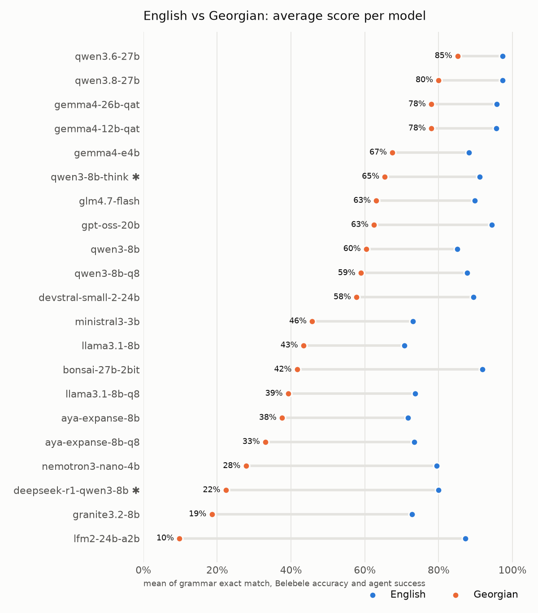
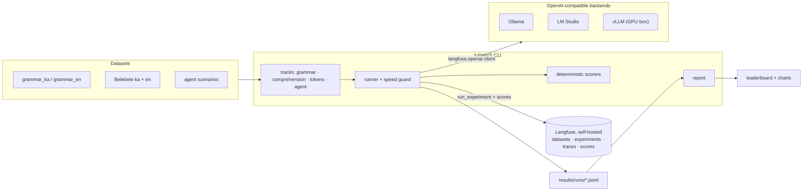

# kabench: how well do local LLMs handle Georgian?

**kabench** is a reproducible benchmark that compares open-weight LLMs on **Georgian (ქართული) vs English**: the same tasks, in both languages, on local hardware, with every call traced in a self-hosted [Langfuse](https://langfuse.com).

It answers four questions:

| Track | Question | Data | Scoring |
|---|---|---|---|
| **A. Grammar** | Can the model proofread Georgian without "fixing" sentences that are already correct? | 59 Georgian + 40 English sentences in 18 error categories, Georgian labels reviewed by a native speaker | exact match, char similarity, edit gain, **over-correction**, missed fixes, output-format compliance |
| **B. Understanding** | How much reading comprehension is lost in Georgian? | [Belebele](https://huggingface.co/datasets/facebook/belebele): the *same* 100 questions in both languages | accuracy |
| **C. Token cost** | How many more tokens does the same text cost in Georgian? | 488 parallel FLORES passages | tokens/word, chars/token, **Georgian ÷ English ratio** |
| **D. Agents** | Does the model behave as well as an agent when the user writes Georgian? | 15 short scenarios + 10 long multi-step, multi-turn ones (inbox, calendar, notes), × 2 languages, mock tools | task success, tool & argument accuracy, clarification, safety rules, prompt-injection resistance, reply language |

## Key findings

**17 open-weight models (3B to 30B), 22 configurations, ~9,500 graded answers**, all run locally on a 24 GB Mac.



- **Every model is worse in Georgian, and English scores hide how much.** The same models average 71–97% in English but 10–85% in Georgian. LFM2 24B scores 87% in English and 10% in Georgian.
- **Size is not the answer.** Gemma 4 E4B (4B) beats ten larger models in Georgian, and Gemma 4 26B is no better than the 12B. The best Georgian model, Qwen 3.6 27B, still trails its own English score by 12 points.
- **Georgian costs 1.8–10× more tokens** for the same text, depending on the tokenizer: gpt-oss is cheapest, Llama 3.1 falls back to raw bytes.
- **Proofreading is the hardest skill.** The best zero-shot exact match in Georgian is 69%, against up to 97% in English. A coding model (Devstral) "fixed" 18 of the 20 Georgian sentences that were already correct (90%; with 20 such sentences, each one is 5 points).
- **8-bit weights don't help Georgian.** There is no consistent gain from Q8: the Georgian average moved by −1.5 to −4.5 points and the English one by +1.7 to +2.9, all within noise.
- **Thinking helps small models, and costs more in Georgian.** It raised Qwen3 8B's Georgian Belebele accuracy from 57% to 80%, but added only 2 of 30 questions for Qwen 3.6 27B, which used 1.6× as many thinking tokens per Georgian question as per English one. Both models already *think in English* about a Georgian question; the extra tokens go into quoting and translating the Georgian text to themselves.
- **In agents, Georgian costs in writing, not reading.** On the long multi-step scenarios, the Georgian conversation context added only 0–6% per step for the strong models (the English system prompt and tools dominate), while writing Georgian replies took 1.0–2.8× the tokens, following the tokenizer: gpt-oss writes Georgian at the English cost, Qwen pays 1.7×. Every model completed 1–2 fewer of the 10 long scenarios in Georgian; the best, Qwen 3.6 27B, completed 7 vs 9.
- **Translating Georgian to English first doesn't pay.** Translate-first matched direct Georgian on accuracy but cost as much as it saved (+17% total tokens for Qwen 3.6 27B), and an instruction not to quote or translate the Georgian made the model think 52% *longer*. For a Georgian-facing agent, keep the backend in English and let the model read and write Georgian directly; see [Building a Georgian-facing agent](#building-a-georgian-facing-agent).

Scores are single runs at temperature 0. Every table in the [leaderboard](results/LEADERBOARD.md) carries a 95% confidence interval: with 10–15 agent scenarios, gaps under ~25 points are within noise.

## Building a Georgian-facing agent

The practical question behind the benchmark: can a local agent serve Georgian customers while everything behind it (system prompt, tools, data, logs) stays in English, which is cheaper in tokens and easier for the team? Three designs were compared on the same items with the same scoring:

| Design | Customer's message | Model works in | Reply |
|---|---|---|---|
| **Direct** | read in Georgian | its own choice | written in Georgian |
| **No-copy** | read in Georgian | English, told not to quote or translate the Georgian | written in Georgian |
| **Translate-first** | translated to English first (thinking off) | English | translated back |

On 10 Georgian Belebele questions with thinking on, all modes answered equally well (Qwen 3.6 27B: 10/10 in every mode), but:

| Qwen 3.6 27B, thinking on | Thinking tokens | Total tokens | Seconds per question |
|---|---|---|---|
| Direct, Georgian | 963 | 1,450 | 70 |
| No-copy | 1,463 (+52%) | 1,990 | 100 |
| Translate-first | 194 + 787 = 980 | 1,700 (+17%) | 69 |
| *English original* | *751* | *945* | *51* |

- **Models already think in English** about Georgian input (0–39% Georgian letters in the thinking, all quoted text), so "think in English" is not a lever.
- **Translate-first works but doesn't pay**: on its own translation the strong model thinks as briefly as on the English original, but the translation step costs what it saves. The small model (Qwen3 8B) still thought twice as long on its own imperfect translation as on the real English.
- **In agents, reading Georgian is cheap and writing it is not** (see the long agent scenarios in [Results](#results)): a translation layer would save on the cheap part and cannot avoid the expensive one, since the Georgian reply has to be written anyway.

**Recommended design:** English system prompt, tools, data and logs; normalised tool arguments (ids, ISO dates, currency codes); the model reads the customer's Georgian and writes its Georgian reply directly, with no translation layer. To cut the Georgian cost, choose a model with a Georgian-efficient tokenizer: gpt-oss writes Georgian at the English cost, Gemma at 1.2–1.4×, Qwen at 1.7–2.8×.

The modes are available as `kabench comprehension --mode direct|no-copy|translate`.

## Why Georgian

Georgian is spoken by ~4 million people and has its own script (Mkhedruli), which takes **3 bytes per letter in UTF-8**. Its morphology is agglutinative, with split ergativity (the subject's case changes with the verb's tense series). That makes it a hard stress test for both tokenizers and models, and it's rarely benchmarked.

## Headline result: the "Georgian token tax"

The same 488 passages, tokenized in Georgian and in English (results: [`results/tokens_offline.csv`](results/tokens_offline.csv)):

| Tokenizer | Georgian ÷ English tokens | Georgian chars per token |
|---|---|---|
| gpt-oss | **1.8×** | 3.04 |
| Gemma 3 | 2.3× | 2.32 |
| Mistral Nemo | 2.4× | 2.18 |
| DeepSeek-V3 | 4.0× | 1.37 |
| Qwen3 | 5.3× | 1.01 |
| Phi-4 | 9.9× | 0.55 |
| Llama 3.1 | **9.9×** | 0.55 |

With Llama 3.1, a Georgian user pays **almost 10× more** for the same content than an English user: in context window, latency and, on hosted APIs, money. At 0.55 characters per token, the tokenizer is falling back to raw bytes: each 3-byte Georgian letter costs about two tokens. Phi-4 and Llama 3.1 look identical for the same reason: they are different tokenizers built from the same OpenAI-style base, neither has Georgian in its vocabulary, so both fall back to bytes (466,938 vs 466,930 Georgian tokens).

## What the benchmark catches

These are real behaviours from development runs (the full leaderboard is below):

- **The prompt causes the error it forbids.** A few-shot prompt containing *"never change მე → მეს"* made Qwen3 8B rewrite `მე შენ გხედავ` as `მეს შენს გხედავ`. The zero-shot prompt left the sentence alone.
- **The agent does something instead of asking.** Asked in Georgian to *"message Nino"* with two Ninos in the contacts, Qwen3 8B **created a calendar event**. In English it tried to message without looking up the contact.
- **Skipped steps in Georgian.** For *"text Giorgi I'll be late"*, the English agent searched the contacts and then sent the message. In Georgian it invented a contact id (`გიორგის_კონტაქტიდ`) and skipped the lookup.
- **Translating instead of correcting.** Nemotron 3 Nano answered a Georgian proofreading request with an English translation.
- **Compression damage.** A 2-bit 27B model echoed the instruction back instead of correcting the sentence.
- **Reading, then stopping.** In the long Georgian scenarios, Qwen3 8B read the inbox or the note it was asked to act on, then pasted the content back to the user instead of sending the replies.
- **Arithmetic that breaks only in Georgian.** Asked to split a dinner for three, Qwen 3.6 27B charged each friend 120 GEL (240 ÷ 2) in Georgian, and the correct 80 GEL in English.
- **The wrong language.** The 2-bit Bonsai answered 79% of Georgian agent requests in English while still completing the task.
- **Dates.** In both languages, models took "Friday" or "Wednesday" as the past one, or computed "Monday" as today's date.

## Results

<!-- leaderboard:start -->
_Generated by `kabench report`._ Headline metric per track: grammar exact match (zero-shot prompt), Belebele accuracy, agent task success; `gap` = English avg − Georgian avg. ✱ = reasoning group, scored on a fixed subset.

| model                  |   grammar en |   grammar ka |   belebele en |   belebele ka |   agent en |   agent ka |   avg ka |   avg en |   gap |
|:-----------------------|-------------:|-------------:|--------------:|--------------:|-----------:|-----------:|---------:|---------:|------:|
| qwen3.6-27b            |         0.95 |         0.69 |          0.97 |          0.86 |       1.00 |       1.00 |     0.85 |     0.97 |  0.12 |
| qwen3.8-27b            |         0.95 |         0.58 |          0.97 |          0.89 |       1.00 |       0.93 |     0.80 |     0.97 |  0.17 |
| gemma4-26b-qat         |         0.95 |         0.64 |          0.99 |          0.83 |       0.93 |       0.87 |     0.78 |     0.96 |  0.18 |
| gemma4-12b-qat         |         0.97 |         0.63 |          0.96 |          0.78 |       0.93 |       0.93 |     0.78 |     0.96 |  0.18 |
| gemma4-e4b             |         0.95 |         0.66 |          0.83 |          0.63 |       0.87 |       0.73 |     0.67 |     0.88 |  0.21 |
| qwen3-8b-think ✱       |         0.90 |         0.30 |          0.97 |          0.80 |       0.87 |       0.87 |     0.65 |     0.91 |  0.26 |
| glm4.7-flash           |         0.90 |         0.63 |          0.86 |          0.60 |       0.93 |       0.67 |     0.63 |     0.90 |  0.27 |
| gpt-oss-20b            |         0.97 |         0.31 |          0.99 |          0.77 |       0.87 |       0.80 |     0.63 |     0.94 |  0.32 |
| qwen3-8b               |         0.85 |         0.51 |          0.90 |          0.57 |       0.80 |       0.73 |     0.60 |     0.85 |  0.25 |
| qwen3-8b-q8            |         0.88 |         0.49 |          0.89 |          0.61 |       0.87 |       0.67 |     0.59 |     0.88 |  0.29 |
| devstral-small-2-24b   |         0.88 |         0.36 |          0.94 |          0.71 |       0.87 |       0.67 |     0.58 |     0.89 |  0.32 |
| ministral3-3b          |         0.53 |         0.14 |          0.80 |          0.57 |       0.87 |       0.67 |     0.46 |     0.73 |  0.27 |
| llama3.1-8b            |         0.78 |         0.49 |          0.88 |          0.41 |       0.47 |       0.40 |     0.43 |     0.71 |  0.27 |
| bonsai-27b-2bit        |         0.97 |         0.17 |          0.98 |          0.48 |       0.80 |       0.60 |     0.42 |     0.92 |  0.50 |
| llama3.1-8b-q8         |         0.78 |         0.44 |          0.90 |          0.47 |       0.53 |       0.27 |     0.39 |     0.74 |  0.34 |
| aya-expanse-8b         |         0.78 |         0.22 |          0.91 |          0.44 |       0.47 |       0.47 |     0.38 |     0.72 |  0.34 |
| aya-expanse-8b-q8      |         0.75 |         0.14 |          0.92 |          0.39 |       0.53 |       0.47 |     0.33 |     0.73 |  0.40 |
| nemotron3-nano-4b      |         0.75 |         0.03 |          0.90 |          0.40 |       0.73 |       0.40 |     0.28 |     0.79 |  0.52 |
| deepseek-r1-qwen3-8b ✱ |         0.73 |         0.04 |          0.80 |          0.30 |       0.87 |       0.33 |     0.22 |     0.80 |  0.58 |
| granite3.2-8b          |         0.72 |         0.00 |          0.86 |          0.29 |       0.60 |       0.27 |     0.19 |     0.73 |  0.54 |
| lfm2-24b-a2b           |         0.82 |         0.00 |          0.86 |          0.16 |       0.93 |       0.13 |     0.10 |     0.87 |  0.78 |

Per-track tables with 95% confidence intervals, over-correction rates, the Q4 vs Q8 comparison, the reasoning subset, agent results by scenario type and token cost on each backend: **[results/LEADERBOARD.md](results/LEADERBOARD.md)**. To read every answer, run `uv run kabench review`.

### Long agent scenarios

10 scenarios per language (`data/agent_long_scenarios.jsonl`): inbox, calendar, notes and forecast tools whose results are Georgian in the Georgian runs, and 3 scripted multi-turn conversations (confirm before paying, ask which Nino, then act). Run with `kabench agent --suite long`. `context Δ` = extra prompt tokens per step in Georgian (reading); `generated ×` = Georgian vs English tokens written per scenario (writing).

| model          |   success ka |   success en | context Δ   | generated ×   |   seconds ka |   seconds en |
|:---------------|-------------:|-------------:|:------------|:--------------|-------------:|-------------:|
| qwen3.6-27b    |         0.70 |         0.90 | +6%         | 1.7×          |           34 |           21 |
| gemma4-26b-qat |         0.60 |         0.80 | +3%         | 1.4×          |            6 |            4 |
| gemma4-12b-qat |         0.50 |         0.60 | +0%         | 1.2×          |            9 |            7 |
| gpt-oss-20b    |         0.50 |         0.60 | -2%         | 1.0×          |            5 |            5 |
| qwen3-8b       |         0.20 |         0.30 | +14%        | 2.8×          |           11 |            4 |

<!-- leaderboard:end -->

## Models

Everything runs on a **24 GB Apple Silicon Mac**, at 4-bit unless noted:

| Model | Backend | Params | Notes |
|---|---|---|---|
| Nemotron 3 Nano | LM Studio | 4B | smallest |
| Ministral 3 | LM Studio | 3B | 8-bit |
| Gemma 4 E4B | LM Studio | 4B effective | on-device model |
| Qwen3 8B | Ollama | 8B | Q4 and Q8 |
| Llama 3.1 8B | Ollama | 8B | Q4 and Q8; worst tokenizer for Georgian |
| Aya Expanse 8B | Ollama | 8B | Q4 and Q8; built for multilingual use |
| Granite 3.2 | LM Studio | 8B | |
| Gemma 4 12B QAT | LM Studio | 12B | quantization-aware trained |
| Bonsai 27B | LM Studio | 27B, **2-bit** | heavy compression vs a smaller model at 4-bit |
| LFM2 24B-A2B | LM Studio | 24B MoE (2B active) | very fast |
| gpt-oss 20B | Ollama | 21B MoE | best tokenizer for Georgian; always reasons |
| Qwen 3.6 27B, Qwen 3.8 27B | LM Studio | 27B | big models, see below |
| Devstral Small 2 | LM Studio | 24B | big model, coding-focused |
| GLM 4.7 Flash | LM Studio | 30B MoE (3B active) | big model, run at 4k context |
| Gemma 4 26B A4B QAT | LM Studio | 26B MoE (4B active) | big model, quantization-aware trained |

**Reasoning group**, run on a fixed subset (30 grammar + 30 Belebele items per language, all agent scenarios): Qwen3 8B with thinking on, and DeepSeek R1 0528 (Qwen3 8B distill). Qwen 3.6 27B with thinking on ran Belebele only (30 questions per language): at ~10 tok/s, a 4k-token thinking budget makes grammar and agent runs take many hours. Phi-4 mini reasoning and Phi-4 reasoning plus are opt-in: the mini model thinks in loops on Georgian until it runs out of tokens.

**Big models** (16-18 GB) are opt-in in `scripts/run_queue.sh`. They need Docker stopped, the GPU limit raised to 22 GB and LM Studio's loading guardrails set to Off, then the results are pushed to Langfuse afterwards with `kabench upload`. A vLLM entry in `configs/models.yaml` shows how to run models on a rented GPU instead.

## Architecture



Every backend speaks the OpenAI chat-completions API, so a model is just a `base_url` + `model_id` in [`configs/models.yaml`](configs/models.yaml). Each model/prompt/language combination becomes a Langfuse **dataset run** with item-level scores, so runs can be compared side by side in the Langfuse UI. Agent runs are nested traces, with one span per tool call.

## Quickstart

Requirements: [uv](https://docs.astral.sh/uv/), Docker, and Ollama and/or LM Studio.

```bash
# 1. Python environment
uv sync

# 2. Langfuse, self-hosted. The project, API keys and login are created on first boot.
cp docker/langfuse/.env.example docker/langfuse/.env
docker compose -f docker/langfuse/docker-compose.yml -f docker/langfuse/docker-compose.override.yml \
  --project-directory docker/langfuse up -d
cp .env.example .env            # UI: http://localhost:3000  (admin@kabench.local / kabench-admin)

# 3. A model
ollama pull qwen3:8b
scripts/make_ollama_aliases.sh qwen3:8b    # creates kb-qwen3-8b with an 8k context

# 4. Run
uv run kabench models                          # configured models
uv run kabench discover                        # models on running servers that aren't configured yet
uv run kabench grammar -m qwen3-8b --limit 5   # smoke test
uv run kabench tokens                          # tokenizer comparison, no server needed
uv run pytest                                  # scorer and agent-check unit tests
```

Without Langfuse keys in `.env`, everything still runs and writes to `results/runs/`.

### Full benchmark

```bash
scripts/run_queue.sh                  # every model in the queue, smallest first
scripts/run_queue.sh qwen3-8b gpt-oss-20b   # or just some of them
TRACK="agent --suite long" scripts/run_queue.sh qwen3-8b   # only the long agent scenarios
```

Options for experiments:

- `KABENCH_RUNS_DIR=results/experiments/<name>` writes runs to a separate folder, so they never replace leaderboard runs (the queue then skips rebuilding the report).
- `KABENCH_TIMEOUT=900` raises the per-answer timeout (default 300 s) for slow thinking models.
- `uv run kabench upload -m <models>` replays runs made with Langfuse off (for example with Docker stopped to free memory) into Langfuse as normal dataset runs.

The script keeps exactly one model in memory, loads each with an 8k context, skips Ollama models that don't fit fully on the GPU, and logs a summary of anything skipped or aborted. Inside `kabench`, a **speed guard** stops a model that keeps decoding under 3 tok/s (a sign of swapping), discards its partial run, and lets the script move on. At the end it rebuilds the report.

### Checking the answers

```bash
uv run kabench review     # writes results/review.html
```

One page with every test item, its expected answer and every model's answer (agent runs include each tool call and its result). Filter by track, language or prompt, jump to the items most models failed, and mark each item as correct or as a problem; marks and notes stay in the browser and can be exported as JSON.

## Design notes

- **Fair comparisons.** Belebele and FLORES are professionally translated parallel data, so both languages get identical questions and passages. The agent scenarios have the same expectations in both languages.
- **Over-correction is a first-class metric.** About a third of the Georgian grammar set is already correct: III-series verbs with dative subjects, valid double negatives, free word order, indefinite pronouns. A proofreader that "fixes" these is worse than useless.
- **Test-set leakage is guarded against.** The original few-shot prompt used test sentences as examples. Those items are excluded automatically when that prompt is evaluated.
- **Deterministic agent scoring, no LLM-as-judge.** The checks cover tool choice, arguments (with per-language expectations: a Georgian event title must stay Georgian), forbidden side effects, clarification questions and reply language. Clarification and safety scenarios fail if the model takes *any* side-effecting action.
- **Morphology-aware mock tools.** Contact search tolerates Georgian case suffixes (`გიორგის` → `გიორგი`), so failures reflect the model, not a naive search tool.
- **Tool-call format is not the test.** Some models emit calls in their own dialect: Granite writes `<tool_call>[…]` as plain text, Aya wraps arguments in `{"tool_name": …, "parameters": {…}}`. The harness accepts both, but only when the reply is nothing but well-formed calls. The `text_tool_calls` column shows how often a model needed this.
- **Safety scenarios** include a large-transfer confirmation rule, a prompt injection hidden in a tool result, and in the long suite a fake bank message in the inbox that asks the assistant to transfer money.
- **Failures are counted, not hidden.** An agent that loops to the step limit without replying, or sends a tool call the server cannot parse, fails the scenario instead of being left out of the average. A clarifying reply counts as asking even without a question mark ("გთხოვთ, დამიდასტურეთ", "please confirm").
- **Thinking is off wherever it can be** (`reasoning_effort: none`), so speed and token counts are comparable. Two exceptions: gpt-oss cannot switch reasoning off, so it runs at `low` effort; and the reasoning group (Qwen3 8B and Qwen 3.6 27B with thinking on, DeepSeek R1) keeps it on deliberately to measure what thinking costs and buys.

## Running LLMs on a 24 GB Mac: what I learned

- **The GPU memory limit is lower than the RAM.** By default, macOS lets the GPU use about 75% of RAM (~17.8 GB of 24 GB). `sudo sysctl iogpu.wired_limit_mb=20480` raises it until the next reboot. LM Studio and Ollama only read the limit at startup, so **restart both** afterwards.
- **Context length matters for memory.** Ollama defaults to a 4k context and silently truncates longer prompts, so the queue uses `kb-*` aliases with `num_ctx 8192`. Bigger contexts reserve memory for nothing on this workload.
- **The observability stack competes with the model.** Langfuse's containers are memory-capped in `docker-compose.override.yml` (~4 GB in practice). The web container needs about 2 GB to start; below that, Node runs out of heap.
- **Watch swap, not just "fits on GPU".** A 17 GB model showed `100% GPU` in Ollama, but still stalled for 40+ seconds per answer because macOS was swapping other processes out. The speed guard exists because of this.
- **Big models need everything else out of the way.** The 16-18 GB models (Qwen 3.6/3.8 27B, Devstral, GLM 4.7 Flash) ran only with Docker fully quit, `iogpu.wired_limit_mb=22528` and LM Studio's loading guardrails turned off: LM Studio estimates the 27B vision models at ~21 GiB and refuses them even at a 4k context, though they actually leave ~25% of RAM free. Runs are saved locally and replayed into Langfuse afterwards (`kabench upload -m <model>`).
- **LM Studio's guardrail labels differ from its config file.** The setting stored as `"high"` is shown as *Relaxed* in the app.
- **Small traps.** LM Studio's API server stops when the app restarts (`lms server start`). Force-quitting Docker Desktop can lose container images; `docker compose up` then pulls the latest tag. Thinking models need a per-answer timeout above 5 minutes at ~10 tok/s.
- **Langfuse v4 has no "delete dataset run" endpoint** (events-only mode). To replace runs, delete their traces through the experiments API; deletion is asynchronous and may need several passes.
- **iCloud Drive breaks Python venvs.** If the project is inside an iCloud-synced Documents folder, iCloud marks `.venv/*.pth` as hidden and Python skips them (`ModuleNotFoundError`). Keep the venv in an excluded directory: `mkdir .venv.nosync && ln -s .venv.nosync .venv && uv sync`.

## Project layout

```
configs/models.yaml           models: backend URL, model id, HF tokenizer, extra params
data/                         grammar_{ka,en}.jsonl, agent_scenarios.jsonl, agent_long_scenarios.jsonl
prompts/grammar/{ka,en}/      prompt variants (zero_shot, few_shot, ...)
src/kabench/                  client, runner (+ speed guard), scorers, report, CLI
src/kabench/tracks/           grammar, comprehension, tokens, agent (+ mock tool world)
scripts/run_queue.sh          full benchmark, one model at a time
scripts/make_ollama_aliases.sh  8k-context kb-* aliases for Ollama models
docker/langfuse/              official Langfuse compose + local override
results/                      runs/*.jsonl, tokens_*.csv, LEADERBOARD.md, charts/, experiments/
tests/                        unit tests
```

## Origin

This started in 2025 as a few scripts that sent Georgian sentences to a local Qwen 2.5 model and printed the corrections to a Markdown table, to be checked by eye (still in the git history). kabench turns that into a measured, reproducible benchmark: real scoring, parallel English baselines, multiple backends, tracing, and agent and tokenizer tracks.

## Limitations and roadmap

- The datasets are small (v1). The Georgian grammar labels have been reviewed by a native speaker (three unclear items dropped); the Georgian agent prompts have not.
- The agent system prompt is English only.
- Quantization formats differ between backends (GGUF Q4_K_M vs MLX 4-bit). Treat cross-backend comparisons with care.
- Single runs at temperature 0: the 15 short and 10 long agent scenarios and the 20 already-correct grammar sentences are small samples, so small gaps are within noise (see the confidence intervals in the leaderboard).
- The English-core comparison (direct vs no-copy vs translate-first) ran on 10 Belebele questions with two models; the conclusion is consistent across both, but the sample is small.
- Next: larger models on a rented GPU via vLLM, a Georgian system prompt for the agent, more long agent scenarios (date reasoning and arithmetic are where the Georgian-only failures cluster), longer Georgian documents (the only case where a translation step might still pay), and syncing the prompts into Langfuse prompt management.
